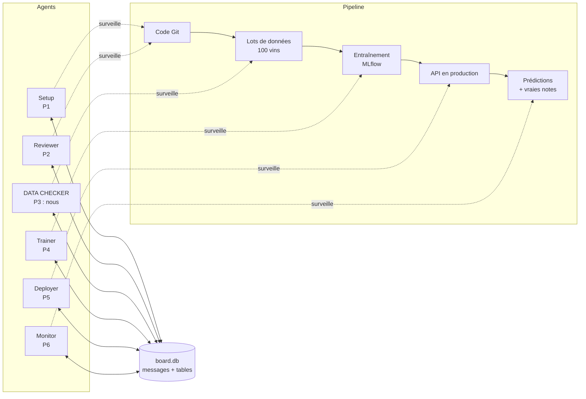
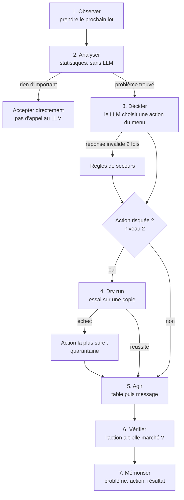
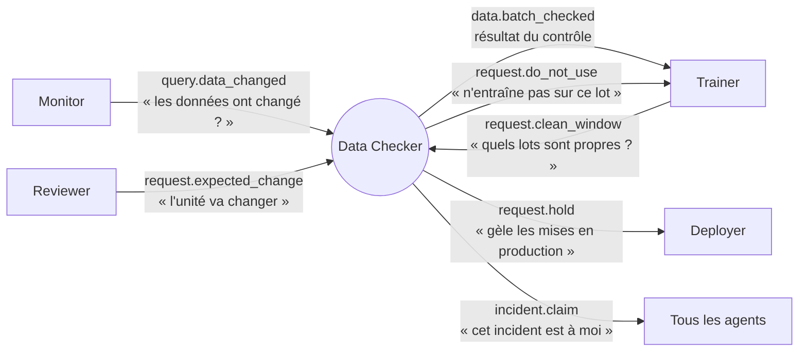
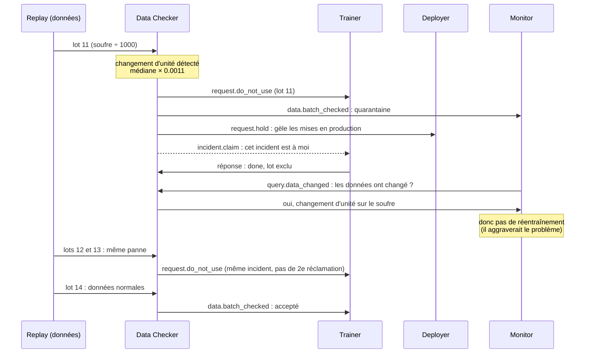
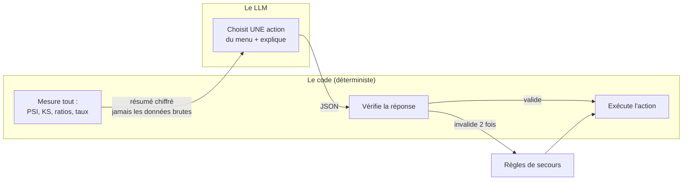
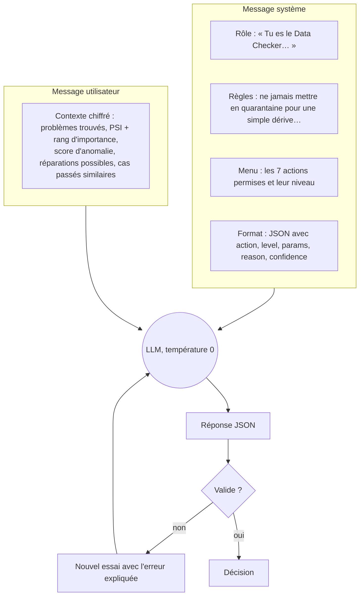
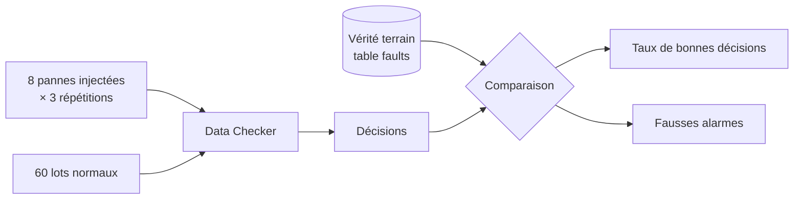
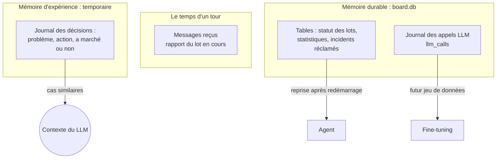
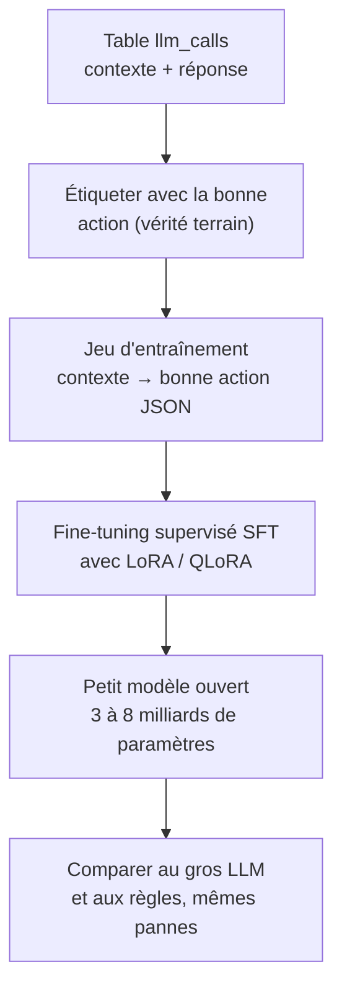
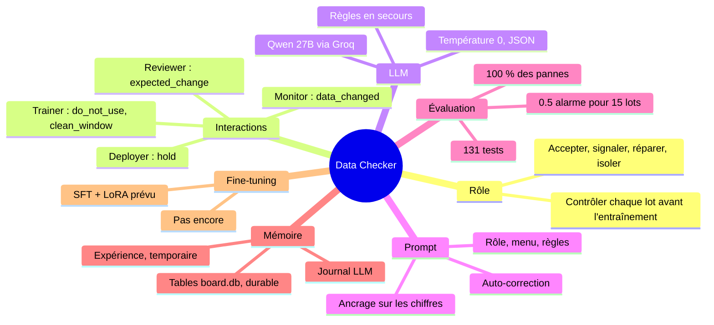

# Le Data Checker expliqué

Ce document explique, avec des schémas, ce que fait le projet, le rôle de notre agent, ses
échanges avec les autres agents, le LLM, les techniques de prompt, l'évaluation, la mémoire et le
fine-tuning. Pour les détails techniques d'intégration, voir `INTEGRATION.md`.

---

## 1. Le projet en une page

**Le modèle** prédit la note d'un vin (0 à 10) à partir de 11 mesures chimiques : acidité, sucre,
soufre, pH, alcool… Il tourne derrière une API (FastAPI), il est enregistré dans MLflow et surveillé
avec Prometheus et Grafana.

**Le problème** : un pipeline MLOps classique tourne « à l'aveugle ». Si les données arrivent dans
une mauvaise unité, si le modèle se dégrade, ou si une nouvelle version est moins bonne pour
certains vins, personne ne s'en rend compte tout de suite.

**Notre solution** : **6 agents**, chacun surveille une étape du pipeline, décide avec un LLM
(avec des règles en secours), et ils se parlent par **messages** sur un tableau commun (`board.db`).

| Agent | Question à laquelle il répond | État |
|---|---|---|
| Setup (P1) | Le dépôt peut-il tourner comme un pipeline ? | en cours |
| Reviewer (P2) | Ce commit change-t-il une variable sans le vouloir ? | en cours |
| **Data Checker (P3)** | **Ce lot de données est-il utilisable ?** | **fini, intégré avec le Trainer** |
| Trainer (P4) | Faut-il réentraîner ? Le nouveau modèle est-il meilleur pour tout le monde ? | fini |
| Deployer (P5) | Quelle part du trafic donner au nouveau modèle ? Faut-il revenir en arrière ? | en cours |
| Monitor (P6) | Le modèle se dégrade-t-il, et à cause de quoi ? | en cours |

---

## 2. Le rôle de notre agent

À chaque nouveau lot de 100 vins, le Data Checker décide **avant** que ces données servent à
l'entraînement :

| Décision | Quand | Exemple |
|---|---|---|
| **Accepter** (`pass`) | rien d'important | lot normal |
| **Accepter et signaler** (`warn`, `pass_with_warning`) | les données sont valides mais différentes | un lot de vins blancs |
| **Réparer** (`repair`) | erreur corrigeable sans risque, testée d'abord sur une copie | 20 % de doublons |
| **Mettre en quarantaine** (`quarantine`) | erreur dangereuse ou irréparable | soufre en g/L au lieu de mg/L |

Il possède aussi des **pièces communes** à toute l'équipe : la boucle de décision des agents
(`shared/base_agent.py`), l'horloge simulée, les tables de données, et le simulateur qui rejoue les
lots et injecte des pannes (`harness/`).

### Comment il pense : la boucle en 7 étapes

### Ce que l'analyse détecte (étape 2, sans LLM)

| Contrôle | Ce qu'il repère |
|---|---|
| Schéma (Pandera) | valeurs physiquement impossibles (pH de 9) |
| Colonnes | colonne manquante, nouvelle, renommée, ou de type changé |
| Valeurs manquantes | hausse anormale des cases vides |
| Changement d'unité | médiane **et** quartiles multipliés par le même facteur (×10, ×100, ×1000) |
| Doublons | le même vin (`wine_id`) deux fois |
| Dérive | test PSI corrigé du bruit **et** confirmé par le test de Kolmogorov-Smirnov |
| Isolation Forest | lot globalement anormal |

Chaque problème est pondéré par l'**importance de la variable pour le modèle** (venant du Trainer).
Une vraie erreur de données compte toujours, une simple dérive compte selon cette importance.

---

## 3. Les interactions avec les autres agents

Les agents ne s'appellent jamais directement : ils **postent des messages** sur le tableau et
**écrivent l'état dans des tables** (pour qu'un agent redémarré retrouve où il en était).

| Table partagée (`board.db`) | Rôle |
|---|---|
| `batches` | statut de chaque lot (`pending`, `passed`, `repaired`, `quarantined`) et le fichier à entraîner (`path`) |
| `batch_stats` | statistiques de chaque lot (médiane, taux de vides…) |
| `labels` | les vraies notes, qui arrivent avec un jour de retard |
| `claims` | quels incidents notre agent a réclamés (gardé après un redémarrage) |
| `llm_calls` | chaque appel au LLM |

### Un exemple complet : le scénario C

Le fournisseur se met à envoyer le soufre en **g/L au lieu de mg/L** pendant 3 lots.

**Résultat** : un seul incident, une seule réclamation, aucun réentraînement inutile, et les lots
redeviennent acceptés dès que la panne s'arrête.

---

## 4. Le LLM utilisé

| | |
|---|---|
| Modèle | **Qwen** `qwen/qwen3.8-27b` (environ 27 milliards de paramètres) |
| Fournisseur | **Groq**, par une API compatible OpenAI |
| Code | `shared/llm.py`, écrit par le Trainer (P4), utilisé par tous les agents |
| Configuration | `agents.yaml` (section `llm`) ; la clé dans `.env`, jamais dans git |
| Réglages | **température 0**, réponse forcée en JSON, contexte limité à **2 000 tokens** |
| Coût mesuré | environ **0.7 s** et **1 100 à 2 100 tokens** par appel |
| Autres fournisseurs possibles | NVIDIA NIM, Ollama (local), ou « off » (règles seules) : un réglage dans la config |

**Ce que le LLM fait, et ne fait pas :**

Le LLM ne voit **jamais les données brutes**, seulement des chiffres. C'est important, parce que
l'appel part chez un fournisseur externe.

---

## 5. Les techniques de prompt engineering

Le prompt est dans `agents/checker/prompt.md`. `shared/llm.py` y ajoute le menu et le format de
réponse.

| Technique | Ce que ça fait | Pourquoi |
|---|---|---|
| **Role prompting** | le LLM reçoit un rôle précis | il sait quel est son travail |
| **Espace d'action contraint** | il doit choisir dans un menu fixe, au bon niveau | il ne peut pas inventer une action dangereuse |
| **Règles explicites** | « ne jamais réparer ce qui est irréparable »… | on encadre son raisonnement |
| **Sortie structurée (JSON)** | format imposé et mode JSON du fournisseur | le code peut vérifier la réponse automatiquement |
| **Ancrage (grounding)** | il ne reçoit que les chiffres calculés par le code, et doit les citer dans sa raison | il raisonne sur des faits, et on peut contrôler son explication |
| **Mémoire dans le contexte** | les cas passés similaires lui sont fournis | il réutilise ce qui a marché |
| **Auto-correction** | réponse invalide → on la lui renvoie avec l'erreur, une fois | il corrige lui-même son erreur |
| **Repli sur les règles** | 2 réponses invalides → les règles décident | l'agent ne reste jamais bloqué |
| **Température 0** | même question → même réponse | décisions reproductibles |
| **Contexte limité** | au plus 2 000 tokens | coût maîtrisé et pas de données brutes |

C'est du **zero-shot** : le prompt ne contient pas d'exemples de réponses. Ajouter 2 ou 3 exemples
(**few-shot**) serait une amélioration possible.

---

## 6. Les métriques d'évaluation

### Comment on évalue

On **injecte exprès des pannes dont on connaît la bonne réponse**, puis on note les décisions de
l'agent. L'agent ne voit jamais cette « vérité terrain » : elle est dans une table (`faults`) qu'il
ne lit pas.

### Les résultats

| Métrique | Ce qu'elle mesure | Résultat | Objectif |
|---|---|---|---|
| **Pannes bien décidées** | la bonne action sur chaque panne | **100 %** (24/24) | ≥ 90 % |
| **Fausses alarmes** | avertissements sur des lots normaux | **0.5 pour 15 lots** | ≤ 1 |
| **Lots normaux bloqués** | lots sains bloqués ou modifiés à tort | **0 sur 60** | 0 |
| **Scénario C** | le bon enchaînement de messages entre agents | **réussi** | réussi |
| **Réponses invalides du LLM** | réponses hors menu ou JSON cassé | **0** | le moins possible |
| **Latence du LLM** | temps de réponse | **~0.7 s** | — |
| **Coût du LLM** | tokens par appel | **~1 100 à 2 100** | — |
| **Tests automatiques** | chaque comportement vérifié | **131 passent** | tous |

Les 8 pannes testées : changement d'unité, valeurs manquantes, colonne renommée, doublons, pH
impossibles, nouvelle colonne, vins blancs, dérive sur une variable peu importante.

**On compare deux systèmes sur les mêmes lots** : les règles seules (le « pipeline traditionnel »)
et le LLM. Sur ces pannes nettes, le LLM prend les mêmes décisions que les règles, avec des
explications justes.

**À mesurer avec les 6 agents réels** : temps de détection, temps de récupération, bon responsable
de l'incident, réentraînements inutiles, actions dangereuses, sollicitations humaines.

---

## 7. La mémoire de l'agent

L'agent utilise **quatre sortes de mémoire**, qui ne durent pas le même temps :

| Mémoire | Ce qu'elle garde | Durée | Sert à |
|---|---|---|---|
| **Court terme** | les messages et le rapport du lot en cours | un tour de boucle | décider maintenant |
| **Expérience** (`remember` / `similar`) | chaque problème, l'action choisie, si elle a marché | **tant que l'agent tourne** | donner au LLM les cas passés similaires |
| **État durable** (tables de `board.db`) | statut des lots, statistiques, incidents réclamés | **permanente** | reprendre après un redémarrage, partager avec les autres agents |
| **Journal LLM** (`llm_calls`) | chaque prompt, réponse, tokens, latence | **permanente** | analyser le LLM, futur fine-tuning |

La recherche des cas similaires est **simple** : elle compare les mots des problèmes, sans base
vectorielle. La mémoire d'expérience **durable** (`shared/memory.py`) est confiée au Deployer (P5) :
en attendant, elle est perdue quand l'agent redémarre. Les incidents réclamés, eux, sont déjà gardés
dans la table `claims`.

---

## 8. Le fine-tuning

**On n'a pas fait de fine-tuning.** Le LLM est utilisé tel quel, guidé par le prompt.

**Pourquoi :**
1. **Pas nécessaire pour l'instant** : avec le prompt seul, le LLM prend les bonnes décisions,
   sans réponse invalide.
2. **Pas assez d'exemples** : quelques dizaines d'appels enregistrés, alors qu'il en faut des centaines.
3. **Priorité** : faire marcher les 6 agents ensemble d'abord.

**Ce qui est déjà prêt** : chaque appel est enregistré dans la table `llm_calls` (contexte,
réponse, décision), et on connaît la bonne réponse de chaque panne injectée. C'est exactement le
jeu de données d'un futur fine-tuning.

**La technique qu'on utiliserait :**

| Élément | Choix | Explication simple |
|---|---|---|
| **Type** | **SFT** (supervised fine-tuning) | on montre au modèle des exemples « situation → bonne décision » |
| **Technique** | **LoRA** ou **QLoRA** | on n'entraîne qu'une petite partie du modèle (des « adaptateurs ») ; QLoRA compresse en plus le modèle pour qu'il tienne sur un ordinateur ordinaire |
| **Modèle** | petit modèle ouvert, par exemple Qwen 3B à 8B | gratuit et utilisable en local avec Ollama |
| **Données** | `llm_calls` + la bonne réponse de chaque panne | aucune donnée de vin brute |
| **Évaluation** | les mêmes 8 pannes et lots normaux | même protocole que ci-dessus |

**L'intérêt** : un petit modèle local, plus rapide, gratuit, sans quota ni envoi de données à
l'extérieur, aussi bon que le gros modèle sur cette tâche précise.

---

## 9. En résumé

> **En une phrase :** le code mesure, le LLM décide dans un menu fixe, et le code vérifie avant
> d'agir ; notre agent bloque les vraies pannes sans bloquer les données normales, et il travaille
> déjà avec le Trainer.
