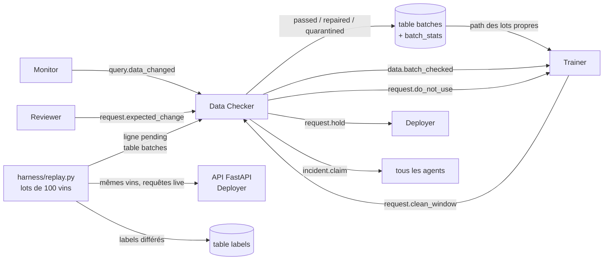

# Data Checker (P3) — ce qu'on a fait et comment l'intégrer

> Pour chaque lot de vins qui arrive, le Data Checker décide **pass, pass_with_warning, warn,
> repair ou quarantine**, pour que les mauvaises données n'atteignent jamais l'entraînement ni le
> modèle en production. P3 possède aussi des pièces partagées : la boucle de base des agents,
> l'horloge, les tables du flux de données et le harness (replay, pannes, scénarios).

## En bref

| | |
|---|---|
| État | **intégré avec le Trainer (P4)** : branche `p3/data-checker`, construite par-dessus `P4_Trainer_agent` |
| Tests | **131 passent** en Python 3.10.11 : P3 + P4 + 6 tests d'intégration Checker ↔ Trainer |
| Scénario C (unité du soufre en g/L) | **PASS** |
| Pannes de données (8 pannes × 3 graines) | **100 %** bien décidées (objectif ≥ 90 %) |
| Lots normaux (60 lots, référence du Trainer) | **0.5 alarme / 15 lots** (objectif ≤ 1), aucun lot bloqué ni réparé |
| LLM | `shared/llm.py` du Trainer, Groq `qwen/qwen3.8-27b` : 3/3 décisions de la démo valides, ~0.7 s par appel |
| Reste à faire | intégrer Reviewer (P2), Deployer (P5), Monitor (P6) quand leurs agents sont finis ; push et pull request |

---

## 1. La place de l'agent dans le système



Le Trainer n'entraîne que sur les lots `passed` ou `repaired`, en lisant leur `path`. Une panne de
flux touche à la fois le lot et les requêtes live : c'est pour ça que le Checker **réclame
l'incident** et demande au Deployer de **geler les mises en production**.

---

## 2. Intégration avec le Trainer (faite)

On a construit notre branche **par-dessus celle du Trainer** et adopté **ses** pièces partagées
quand elles faisaient doublon avec les nôtres. On n'a pas modifié le code de son agent.

| Pièce | Qui la fournit | Ce qu'on utilise |
|---|---|---|
| Boucle de base `shared/base_agent.py` | **P3** | le Trainer en hérite (il garde sa propre boucle `step()`) |
| LLM `shared/llm.py` | **P4** | le Checker décide avec, et les appels vont dans la table `llm_calls` de `board.db` |
| Dry run `shared/dry_run.py` | **P4** | réparations testées en sous-processus (`DRY_RUN=1`) |
| Board `shared/standins.py` → `SqliteBoard` | **P4** (en attendant P6) | les deux agents, sur le même `board.db`, entre processus |
| Référence `samples/reference/` | **P4** | le « normal » du Checker et l'importance des variables viennent du vrai modèle |
| Tables `batches`, `labels` | **P3** (+ P4 lit) | même schéma des deux côtés |

**Ce qui cassait, et ce qu'on a corrigé :**

| Problème trouvé | Correction |
|---|---|
| Le Trainer importe notre `BaseAgent` et plantait (son menu et ses messages sont des `dict`) | `BaseAgent` accepte les `dict` ; nos agents reçoivent toujours des `Message` |
| `shared/llm.py` ne lisait pas notre décision de repli → **le LLM ne tournait jamais**, en silence | le repli est envoyé en `dict`, la réponse est reconvertie ; `llm_invalid` / `llm_error` → `fallback` |
| Le runner de dry run appelle `run(inputs, workdir)` | `repair_check.run(inputs, workdir=None)` |
| Notre runner de pannes plantait sur les pannes « modèle » du Trainer | il accepte aussi la signature `(batch, step, target)` ; le replay applique les pannes `labels` |
| Le Trainer lit `path` (jamais `clean_path`) → un lot réparé aurait été entraîné **non réparé** | après une réparation, `path` pointe vers le fichier réparé ; l'original reste dans `raw_path` |
| Si le Trainer crée la table `batches` en premier, nos colonnes manquaient | `Tables` ajoute les colonnes manquantes au démarrage |
| Après un redémarrage, le Checker **réclamait le même incident une 2e fois** | réclamations gardées dans la table `claims` ; même numéro d'incident après redémarrage |
| `shared/llm.py` : en changeant de fournisseur sans préciser la clé, il envoyait **la clé Groq à NVIDIA** | la variable de clé du nouveau fournisseur est utilisée (correction d'une ligne dans le fichier de P4) |

---

## 3. Ce qu'on a construit

### L'agent — `agents/checker/`

| Fichier | Rôle |
|---|---|
| `agent.py` | `CheckerAgent(BaseAgent)` : les 7 étapes, les réponses aux questions et requêtes ; incidents gardés après redémarrage |
| `analysis.py` | statistiques sans LLM : rapport de lot, `batch_stats`, Isolation Forest, cause probable, réparation en plusieurs passes |
| `checks.py` | les contrôles (génériques, ils viennent de notre ancien Inspector) |
| `profiler.py` | apprend le « normal » à partir des données de référence |
| `repairs.py` | 7 réparations pures (`rename`, `rescale`, `cast_numeric`, `impute`, `drop_duplicates`, `drop_out_of_range`, `drop_rule_violations`) et le plan de réparation |
| `actions.py` | une fonction par action du menu : la table d'abord, puis le message |
| `settings.py` | seuils, référence, importance des features, chemins |
| `prompt.md` | le prompt système du LLM (lu par `shared/llm.py`) |
| `stub.py` + `fixtures/` | le faux Checker pour les coéquipiers ; marche sur `SqliteBoard` ; fixtures **extraites d'une vraie exécution** |
| `__main__.py` | `python -m agents.checker` : même branchement que le Trainer (board, LLM, dry run) |
| `DEMO.md`, `README.md` | script de démo, résumé technique |

### Les pièces partagées (propriété P3)

| Fichier | Rôle |
|---|---|
| `shared/base_agent.py` | la boucle en 7 étapes, les niveaux 0 à 3, la porte de dry run, le repli sur les règles, la carte humaine au niveau 3, un seul traitement par message, et une erreur dans un tour n'arrête jamais l'agent ; accepte les messages `dict` et `Message` |
| `shared/clock.py` | `clock.now()` / `clock.iso()` ; modes `real`, `replay` (1 s réelle = 12 min) et `frozen` (tests) |
| `shared/tables.py` | tables `batches`, `batch_stats`, `labels`, `claims`, `faults` dans `board.db` ; **refuse toute écriture si `DRY_RUN=1`** |
| `shared/testing.py` | remplaçants pour les tests (board en mémoire, faux LLM, mémoire, incidents) ; `inprocess_dry_run` = le runner du Trainer en mode rapide |
| `samples/schema.py` | schéma Pandera `WineBatch` (limites physiques, valables pour le rouge **et** le blanc) + `make_schema(bounds)` |
| `dry_run_jobs/repair_check.py` | le job de dry run : la réparation sur une copie doit passer tous les contrôles avec un PSI < 0.25 |
| `harness/replay.py` | lots de 100 vins tirés avec remise, `wine_id`, requêtes live, labels différés, pannes `labels` |
| `harness/fault_runner.py` + `harness/faults/data/*.yaml` | 8 pannes de données (et celles du Trainer) ; la vérité terrain va dans la table `faults` |
| `harness/scenario_runner.py` + `harness/fakes.py` | joue `scenarios/<id>.yaml` avec les vrais agents et des faux scriptés, puis vérifie les attentes |
| `harness/evaluate_checker.py`, `harness/demo_checker.py`, `harness/demo_ui.py` | mesures chiffrées, démo console, démo web |
| `scenarios/C.yaml` | le scénario C |

### Autres fichiers

- `data/winequality-red.csv`, `data/winequality-white.csv` (fichiers UCI, identiques à ceux du Trainer).
- `agents.yaml` : section `llm` (Groq) et section `agents.checker` ; `.env.example` (sans clé).
- `requirements.txt` : une seule liste, alignée sur le Trainer (`scikit-learn==1.5.1`, `mlflow==2.14.1`…)
  + `pandera`. Le `requirements-agents.txt` du Trainer reste, son Dockerfile l'utilise.

---

## 4. Comment l'agent décide

### Étape 2 — comprendre (sans LLM)

| Contrôle | Ce qu'il détecte |
|---|---|
| Schéma `WineBatch` | valeurs **physiquement impossibles** (pH 9, soufre < 1 mg/dm³) → `schema_range` |
| Colonnes | colonne manquante, nouvelle colonne, **colonne renommée** (même distribution sous un autre nom), type changé |
| Valeurs manquantes | hausse du taux de nulls par rapport à la référence |
| Changement d'unité | la médiane **et** les deux quartiles bougent du même facteur ×10, ×100 ou ×1000 |
| Plage apprise | sortie de la plage de référence **à l'intérieur** des limites physiques → `range_shift` (nouvelle population) |
| Doublons | même `wine_id` deux fois |
| Drift | PSI corrigé du bruit des petits lots **et** confirmé par un test KS (p < 0.05) |
| Isolation Forest | lot globalement anormal (entraîné sur les 10 premiers lots normaux) |

Chaque finding a un **score = gravité × poids** : un drift pèse **l'importance de la feature**
(celle du modèle du Trainer) ; une **erreur de données** sur une feature du modèle pèse **au moins 0.5**.

### Étape 3 — décider

Le LLM (`shared/llm.py`) reçoit un résumé chiffré, jamais de lignes de données, et choisit une
action du menu. S'il échoue ou répond hors menu, on utilise `rule_decision()`, qui sert aussi de
« pipeline traditionnel » (`--llm off`).

| Situation | Décision | Messages |
|---|---|---|
| Rien qui compte pour le modèle | `pass` (sans appeler le LLM) | `data.batch_checked` |
| Erreur qui atteint aussi l'API live : unité, colonne manquante, type, feature invalide sur ≥ 50 % des lignes | `quarantine` | `data.batch_checked`, `request.do_not_use`, **`incident.claim` + `request.hold`** (une fois par incident) |
| Erreur qu'aucune réparation ne corrige (40 % de nulls…) | `quarantine` | `data.batch_checked`, `request.do_not_use` |
| Erreur réparable : doublons, quelques lignes invalides, < 20 % de nulls, colonne renommée | `repair` (niveau 2, **dry run d'abord**) | `data.batch_checked` (status `repaired`) |
| Drift significatif seulement | `warn` | `data.batch_checked`, `data.drift_trend` |
| Autres avertissements (nouvelle colonne, anomalie isolée) | `pass_with_warning` | `data.batch_checked` |

Si le dry run de la réparation échoue, la boucle de base passe à l'action la plus sûre : `quarantine`.

---

## 5. Nos choix de conception, et pourquoi

1. **Erreur ≠ drift dans la pondération.** Si on pondérait tout par l'importance, une erreur sur
   une variable peu utilisée par le modèle serait ignorée, alors qu'elle corrompt l'API live et les
   futurs entraînements. D'où le **poids plancher de 0.5 pour les erreurs**.
2. **100 lignes, c'est bruité.** La médiane du soufre varie de ±20 % d'un lot normal à l'autre.
   Plusieurs seuils dépendent donc de la taille du lot (tolérance d'unité 3/√n, au moins 3 lignes
   hors plage, PSI corrigé du bruit, drift confirmé par le test KS).
3. **Facteurs d'unité propres au dataset** : pour le vin, seulement les puissances de 10 (mg↔g).
4. **Doublons par `wine_id`** : le dataset contient naturellement ~12 % de vins identiques.
5. **Le schéma définit l'impossible, la référence définit l'habituel** : des vins blancs sont un
   avertissement, un pH de 9 est une erreur.
6. **Une erreur de flux qui touche l'API → quarantaine + réclamation**, même si une réparation existait.
7. **Ce qu'il faut après un redémarrage est dans les tables** : statut des lots, fichier à
   entraîner (`path`), réclamations (`claims`).

---

## 6. Messages et tables

### Envoyés par le Checker

| Kind | Type | À | Topic | Payload |
|---|---|---|---|---|
| `data.batch_checked` | finding | trainer, monitor | `dataset:<batch_id>` | `batch_id, status, rows, failed_checks[], psi{}, repair[]`, + `clean_path` |
| `data.drift_trend` | finding | monitor, trainer | `feature:<nom>` | `feature, statistic, slope_per_batch, batches_to_limit` |
| `request.do_not_use` | request | trainer | `dataset:<batch_id>` | `batch_ids[], reason` |
| `request.hold` | request | deployer | `deployment:prod` | `reason, release_condition` |
| `incident.claim` | claim | les 5 autres agents (nommés) | `incident:<id>` | `root_cause_node, evidence_refs[], instructions{agent: action}` |

### Reçus par le Checker

| Kind | De | Réponse (payload) |
|---|---|---|
| `query.data_changed` (`feature, start, end`) | monitor | `changed, batch_ids[], likely_cause` ∈ `unit_change, schema_change, missing_values, late_batch, valid_shift, none` ; réclame l'incident si l'erreur est confirmée et pas encore réclamée |
| `request.clean_window` (`start, end, min_rows`) | trainer | `decision (done/failed), detail, batch_ids[], rows` (lots `passed` + `repaired`) |
| `request.expected_change` (`changes[{name, old, new, factor}], tasks{checker: …}`) | reviewer | `decision, detail, task, done_at` ; nouvelle version du schéma, testée d'abord sur la référence convertie |

Exemples réels : `contracts/examples/<kind>/` et `agents/checker/fixtures/` (validés par `tests/test_contracts.py`).

### Tables (`board.db`)

| Table | Écrite par | Colonnes principales |
|---|---|---|
| `batches` | replay (`pending`), Checker (statut) ; lue par le Trainer | `batch_id, path` (fichier à entraîner)`, status, rows, created_at, checked_at, reason, clean_path, raw_path` (original si réparé)`, schema_version, findings` |
| `batch_stats` | Checker | `batch_id, column_name, null_rate, mean, median, p1, p99` |
| `labels` | replay | `wine_id, quality, available_at` |
| `claims` | Checker | `incident_id, node, agent, claimed_at` |
| `llm_calls` | `shared/llm.py` | un enregistrement par appel au LLM (prompt, réponse, tokens, latence) |
| `faults` | harness seulement | vérité terrain des pannes (**aucun agent ne la lit**) |

---

## 7. Comment l'intégrer

### 7.1 Environnement (tout le monde)

```bash
py install 3.10
py -V:3.10 -m venv .venv
.venv/Scripts/python -m pip install -r requirements.txt
.venv/Scripts/python -m pytest
```

Pour le LLM : `cp .env.example .env`, puis mettre **sa propre** clé Groq dans `.env` (jamais dans git).

### 7.2 Lancer les agents

```bash
.venv/Scripts/python -m agents.checker --db runs/demo/board.db
.venv/Scripts/python -m agents.trainer --db runs/demo/board.db --mlflow http://localhost:5000
```

| Option / variable | Défaut | Rôle |
|---|---|---|
| `--db` / `BOARD_DB` | `board.db` à la racine | le fichier partagé (messages, tables, `llm_calls`) |
| `--llm` | `config` (`agents.yaml` + `.env`) | `off` = règles seules (système traditionnel), ou `groq`, `nvidia_nim`, `ollama`, `fake` |
| `--once` | — | un seul tour, puis arrêt |
| `--poll` / `POLL_S` | `2` | secondes entre deux tours |
| `CLOCK_MODE`, `CLOCK_SPEED`, `CLOCK_START`, `CLOCK_EPOCH` | `real` | horloge partagée ; le harness les fournit avec `clock.env_for_agents()` |
| `CHECKER_DATA_DIR` | `data/checker` | profils, copies réparées et en quarantaine |

Le board est `shared.board.Board` (P6) dès qu'il existe, sinon `SqliteBoard` : **rien à changer dans
l'agent** le jour où P6 livre le sien.

### 7.3 Ce que chaque coéquipier doit savoir

**P4 — Trainer** : rien à changer dans votre agent. Deux choses à savoir :
- après une réparation, `batches.path` pointe vers le fichier réparé (l'original est dans `raw_path`) ;
- une ligne corrigée dans `shared/llm.py` : changer de fournisseur via `config` sans `api_key_env`
  utilise maintenant la clé de ce fournisseur (avant, la clé de `agents.yaml` partait au mauvais fournisseur).

**P6 — Monitor, board** :
- gardez l'API de `SqliteBoard` pour le vrai `shared/board.py` (`post`, `read`, `answer`, `ask`,
  `thread`, `heartbeat`, messages en `dict` validés par `new_message`) : les deux agents marchent déjà dessus ;
- `shared/messages.py` : `time` utilise encore `datetime.now()` ; passer à `clock.iso()` ;
- `query.data_changed` : `feature` en `snake_case`, `start` / `end` en ISO UTC avec `Z`.

**P5 — Deployer, mémoire** :
- `shared/memory.py` : `remember(...)` est appelée **avec des arguments nommés** (`agent, incident_id,
  problem, evidence, action, params, level, outcome, time_to_recover_s`) ; `similar(problem, agent=None, k=5)` ;
- répondre `accepted` à `request.hold` ;
- l'API doit lire `wine_id` : le replay envoie `{"data": [11 valeurs], "wine_id": …}`.

**P2 — Reviewer** : `request.expected_change` avec `changes[{name, old, new, factor}]` et la clé
`"checker"` dans `tasks`.

**P1 — Setup** : seuils dans `agents.yaml` → `agents.checker.thresholds` ; si vous générez le schéma,
gardez l'interface de `samples/schema.py` (`FEATURES`, `make_schema(bounds)`).

### 7.4 Le harness pour toute l'équipe

- **Ajouter une panne** : un YAML dans `harness/faults/<couche>/` ; la fonction `inject` peut être
  `f(df, **target)` ou `f(batch, step, target)`. `python -m harness.fault_runner list` les affiche.
- **Ajouter son agent au runner de scénarios** : une branche dans `real_agent()` de `harness/scenario_runner.py`.

```bash
.venv/Scripts/python -m harness.scenario_runner C
.venv/Scripts/python -m harness.evaluate_checker --seeds 3 --normal 60
.venv/Scripts/python -m harness.demo_checker --llm
.venv/Scripts/python -m harness.demo_ui           # démo web : http://127.0.0.1:8765
```

### 7.5 Checklist avant de fusionner

- [x] `pytest` passe (131 tests, dont `tests/test_integration_trainer.py`)
- [x] `python -m harness.scenario_runner C` → PASS
- [x] `python -m harness.evaluate_checker` → 100 % et 0.5 alarme / 15
- [x] Checker et Trainer en deux processus sur le même `board.db` : une seule réclamation, `do_not_use` → `done`
- [ ] les kinds du §6 dans le catalogue de P6
- [ ] `messages.py` utilise `clock.iso()` pour `time`

---

## 8. Réglages (`agents.yaml` → `agents.checker.thresholds`)

| Clé | Défaut | Sens |
|---|---|---|
| `psi_warn` / `psi_alert` | 0.10 / 0.25 | drift, au-dessus du bruit attendu |
| `ks_p_max` | 0.05 | un drift doit être confirmé par le test KS |
| `error_floor` | 0.5 | poids minimum d'une erreur de données sur une feature du modèle |
| `decision_min_score` | 0.5 | en dessous, le finding est seulement enregistré |
| `isolation_min_batches` | 10 | lots normaux avant d'utiliser l'Isolation Forest |
| `compare_last_batches` | 5 | `query.data_changed` : la fenêtre comparée aux 5 lots précédents |
| `unit_factors` | 10, 0.1, 100, 0.01, 1000, 0.001 | changements d'unité plausibles pour ce dataset |

---

## 9. Limites connues

- **Mémoire d'expérience** : remplaçant en mémoire vive (perdu au redémarrage) en attendant
  `shared/memory.py` de P5.
- **Incidents** : seuls ceux réclamés par le Checker sont gardés après redémarrage (table `claims`) ;
  le module commun d'incidents reste à écrire.
- **Quota Groq gratuit** : certains appels attendent 15 à 25 s. Une clé par membre pour la semaine 4.
- **`release_state`** dans l'état final des scénarios n'est vérifié qu'avec le vrai Deployer.
